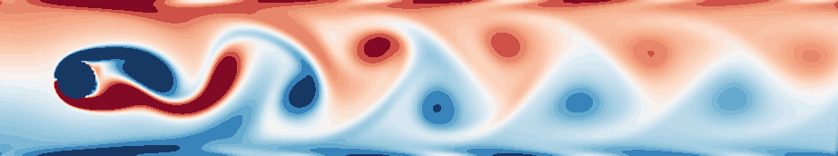
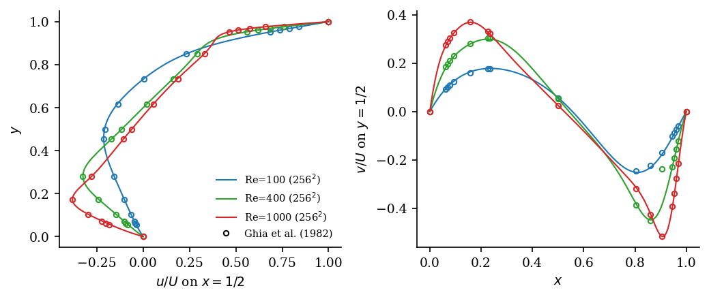
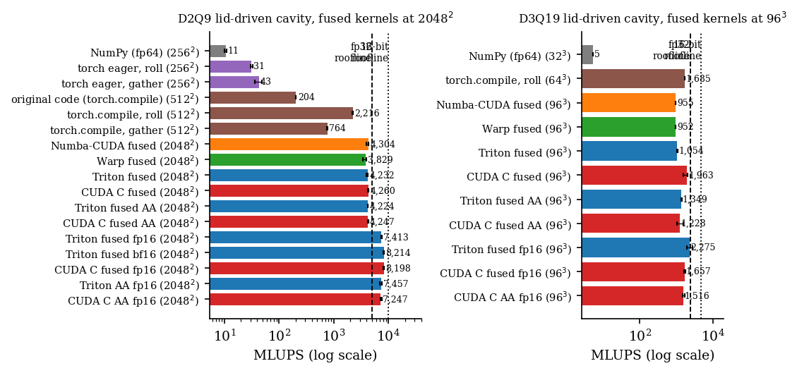
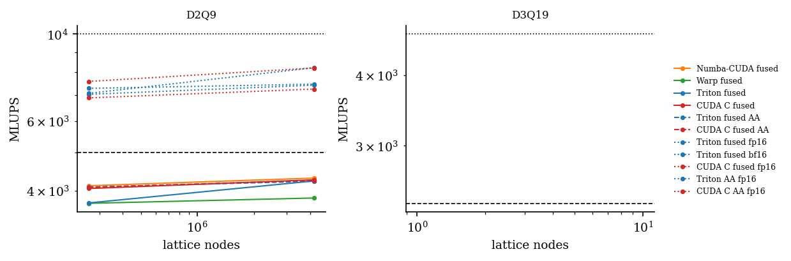

# pylbm

**A lattice-Boltzmann solver that reaches the GPU memory roofline from Python.** Fused
stream-collide kernels in Triton, NVIDIA Warp, Numba-CUDA and CUDA C, validated against
Ghia et al. (1982), Schäfer–Turek (1996), shear-wave decay, Poiseuille and 3D Taylor–Green
flow, with every number traceable to a benchmark JSON.

[](https://github.com/walidhemati/pylbm/actions/workflows/ci.yml)
[](LICENSE)
[](pyproject.toml)
[](paper/paper.pdf)



<!-- BEGIN:headline (generated by figures/make_figures.py) -->
> **Headline (NVIDIA GeForce RTX 3070 Laptop GPU, PROVISIONAL dev run).** D2Q9 fp32: **4,304 MLUPS** (Numba-CUDA fused, 2048x2048) = **86% of the measured 360 GB/s copy bandwidth**, 69% of the 448 GB/s spec.
>
> 16-bit storage: **8,214 MLUPS** (Triton fused bf16, 82% of copy bandwidth at 36 B/update).
>
> D3Q19 fp32: **1,963 MLUPS** (83% of copy bandwidth).
>
> The original script of this repository: 204 MLUPS (21.0x slower than fp32 fused).
>
> Source: `results/quick.json`.
<!-- END:headline -->

## What's inside

| rung | backend / variant | what it is |
|---|---|---|
| 0 | `numpy/roll` | float64 reference, the correctness oracle (runs in CI) |
| 1 | `torch-eager/roll`, `torch-eager/gather` | same algorithm on CUDA tensors; gather = one `torch.take` with a precomputed index table (any geometry) |
| 2 | `torch-compile/original` | the original script of this repository (unchanged, legacy boundaries), the baseline |
| 3 | `torch-compile/roll`, `torch-compile/gather` | Inductor-fused versions of rung 1 |
| 4 | `numba/fused`, `warp/fused`, `triton/fused` | one fused pull kernel per step, **generated from one description** (`pylbm/codegen.py`) |
| 5 | `cupy-cuda-c/fused` | hand-written CUDA C, compiled at run time by NVRTC through CuPy |
| 6 | `triton/fused-aa`, `cupy-cuda-c/fused-aa` | AA-pattern in-place streaming: one population buffer instead of two |
| 7 | `*/fused-fp16`, `triton/fused-bf16`, `*/fused-aa-fp16` | 16-bit storage of shifted populations `f - w` with fp32 arithmetic: half the traffic |

Physics: D2Q9 and D3Q19; BGK, TRT (magic Λ = 3/16) and MRT (Lallemand–Luo, D2Q9); Guo
forcing; half-way bounce-back with Ladd's moving-wall term; periodic axes; solid obstacles,
velocity inlet and pressure outlet in the general (NumPy/PyTorch) solvers. Conventions:
`f[i, y, x]`, x right, y up, lid on top moving in +x (`origin="lower"` when plotting).

## Quick start

```bash
pip install -e ".[gpu,viz,dev]"          # or just "." for the NumPy reference
pylbm backends                            # what runs on this machine
pylbm run cavity --n 512 --re 1000 --steps 50000 --backend triton --variant fused --out cavity.png
pylbm validate                            # full validation suite (GPU, a few minutes)
python bench/run.py --quick               # smoke benchmark (< 2 min)
```

## Validation



<!-- BEGIN:validation (generated by figures/make_figures.py) -->
| check | reference | result |
|---|---|---|
<!-- END:validation -->

Every backend is also checked population-by-population against the float64 NumPy reference
on small cavities, channels and periodic boxes (`tests/test_equivalence.py`).

## Performance



<!-- BEGIN:performance (generated by figures/make_figures.py) -->
Median of 5 timed runs on the NVIDIA GeForce RTX 3070 Laptop GPU; ceiling = measured device copy bandwidth (360 GB/s). **Provisional numbers from a development run on a shared GPU.**

| lattice | rung | size | MLUPS | B/update | GB/s | % copy | % spec |
|---|---|---|---:|---:|---:|---:|---:|
| D2Q9 | NumPy (fp64) | 256x256 | 11 | 144 | 2 | 0 | 0 |
| D2Q9 | torch eager, roll | 256x256 | 31 | 72 | 2 | 1 | 1 |
| D2Q9 | torch eager, gather | 256x256 | 43 | 72 | 3 | 1 | 1 |
| D2Q9 | original code (torch.compile) | 512x512 | 204 | 72 | 15 | 4 | 3 |
| D2Q9 | torch.compile, roll | 512x512 | 2,216 | 72 | 160 | 44 | 36 |
| D2Q9 | torch.compile, gather | 512x512 | 764 | 72 | 55 | 15 | 12 |
| D2Q9 | Numba-CUDA fused | 2048x2048 | 4,304 | 72 | 310 | 86 | 69 |
| D2Q9 | Warp fused | 2048x2048 | 3,829 | 72 | 276 | 77 | 62 |
| D2Q9 | Triton fused | 2048x2048 | 4,232 | 72 | 305 | 85 | 68 |
| D2Q9 | CUDA C fused | 2048x2048 | 4,260 | 72 | 307 | 85 | 68 |
| D2Q9 | Triton fused AA | 2048x2048 | 4,224 | 72 | 304 | 84 | 68 |
| D2Q9 | CUDA C fused AA | 2048x2048 | 4,247 | 72 | 306 | 85 | 68 |
| D2Q9 | Triton fused fp16 | 2048x2048 | 7,413 | 36 | 267 | 74 | 60 |
| D2Q9 | Triton fused bf16 | 2048x2048 | 8,214 | 36 | 296 | 82 | 66 |
| D2Q9 | CUDA C fused fp16 | 2048x2048 | 8,198 | 36 | 295 | 82 | 66 |
| D2Q9 | Triton AA fp16 | 2048x2048 | 7,457 | 36 | 268 | 75 | 60 |
| D2Q9 | CUDA C AA fp16 | 2048x2048 | 7,247 | 36 | 261 | 72 | 58 |
| D3Q19 | NumPy (fp64) | 32x32x32 | 5 | 304 | 2 | 0 | 0 |
| D3Q19 | torch.compile, roll | 64x64x64 | 1,685 | 152 | 256 | 71 | 57 |
| D3Q19 | Numba-CUDA fused | 96x96x96 | 955 | 152 | 145 | 40 | 32 |
| D3Q19 | Warp fused | 96x96x96 | 952 | 152 | 145 | 40 | 32 |
| D3Q19 | Triton fused | 96x96x96 | 1,054 | 152 | 160 | 44 | 36 |
| D3Q19 | CUDA C fused | 96x96x96 | 1,963 | 152 | 298 | 83 | 67 |
| D3Q19 | Triton fused AA | 96x96x96 | 1,349 | 152 | 205 | 57 | 46 |
| D3Q19 | CUDA C fused AA | 96x96x96 | 1,228 | 152 | 187 | 52 | 42 |
| D3Q19 | Triton fused fp16 | 96x96x96 | 2,275 | 76 | 173 | 48 | 39 |
| D3Q19 | CUDA C fused fp16 | 96x96x96 | 1,657 | 76 | 126 | 35 | 28 |
| D3Q19 | CUDA C AA fp16 | 96x96x96 | 1,516 | 76 | 115 | 32 | 26 |
<!-- END:performance -->



## How it works

LBM is bandwidth-bound: a D2Q9 update must read 9 and write 9 populations, 72 B in fp32,
whatever the collision operator. The roofline is therefore *copy bandwidth / 72 B*. The
ladder removes, in turn, NumPy's CPU execution, PyTorch's one-kernel-per-operation launches,
the extra DRAM round trips between partially fused kernels, and finally the bytes themselves:

1. **Fuse** streaming, bounce-back, moving-wall correction and collision into one pull kernel
   per step. Wall tests are coordinate comparisons, so no flag field is read.
2. **Same kernel, four toolchains.** Triton, Warp and Numba kernels are printed from one
   symbolic description, so they execute identical arithmetic; the CUDA C kernel is written
   independently and serves as the hand-tuned reference.
3. **AA pattern** (Bailey et al. 2009): alternate "even" and "odd" kernels that read and write
   the same locations, so one buffer suffices.
4. **16-bit storage** of `f - w` (Lehmann et al. 2022) halves the bytes per update; arithmetic
   stays fp32.

Print any generated kernel with `pylbm kernels --target triton --lattice D3Q19`.

The original script (`legacy/Pytorch_LBM_accelerated.py`) is kept runnable. Wrapping it in the
common interface exposed three defects that the new core fixes: its y-axis is mirrored (the lid
it plots at the top is physically the bottom wall), its side walls reflect specularly instead
of bouncing back, and its lid density uses the wrong populations.

## Reproduce the paper

```bash
python bench/run.py --full          # idle GPU, < 15 min -> results/rtx3070-laptop.json
pylbm validate                      # -> results/validation.json, results/karman_vorticity.npz
python figures/make_figures.py      # -> figures/*.pdf|png, paper/results.tex, README tables
python figures/make_hero.py         # -> docs/media/hero.gif
cd paper && tectonic paper.tex      # -> paper/paper.pdf
```

## Citation

```bibtex
@software{hemati_pylbm_2026,
  author  = {Hemati, Walid},
  title   = {pylbm: a fused-kernel lattice-Boltzmann solver that reaches the GPU memory
             roofline from Python},
  year    = {2026},
  version = {1.0.0},
  url     = {https://github.com/walidhemati/pylbm}
}
```

MIT license, see [LICENSE](LICENSE).

---
<sub>Part of the Python-HPC suite:
[pylbm](https://github.com/walidhemati/pylbm) ·
[pyheat3d](https://github.com/walidhemati/pyheat3d) ·
[pygravity](https://github.com/walidhemati/pygravity) ·
[pymd](https://github.com/walidhemati/pymd) ·
[pyising](https://github.com/walidhemati/pyising) ·
[pyspectral](https://github.com/walidhemati/pyspectral)</sub>
